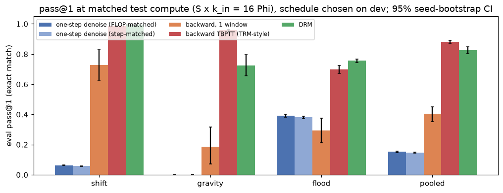
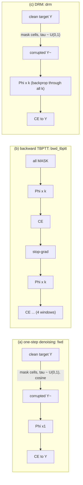
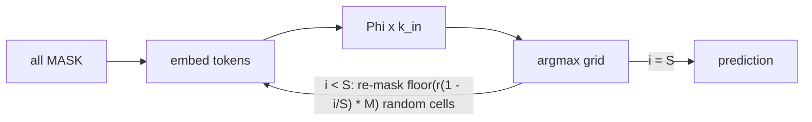
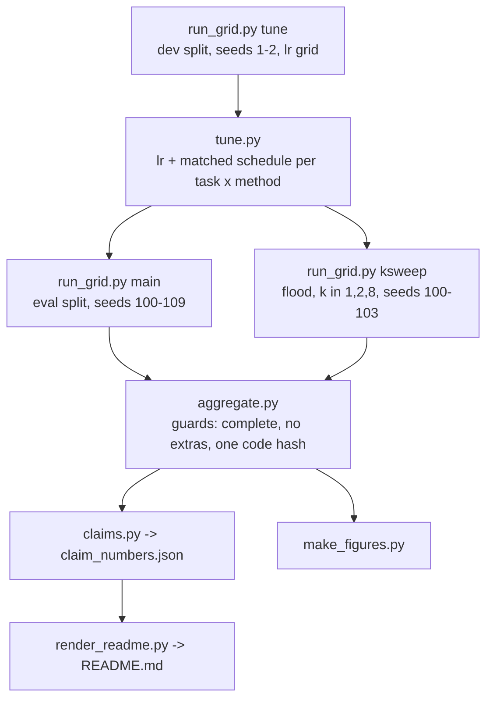

# DRM recursion-curriculum microbench (CPU toy)

A small, CPU-only reproduction of the core idea of **Denoising Recursion Models** (DRM): corrupt the target, then train a shared recursive block to recover it over **k recursive steps** rather than in one jump. It compares DRM with **one-step denoising** (diffusion-style "forward" training) and with **backward recursion from a full mask** (TRM-style TBPTT), all on the same block Phi, at matched parameter count and matched training FLOPs.

> Credit: Cameron, Wang, Ivanov, Bhattacharyya, Chételat and Zhang, *One Step Forward and K Steps Back: Better Reasoning with Denoising Recursion Models*, Huawei Technologies, University of Toronto and University of Waterloo, [arXiv:2604.18839](https://arxiv.org/html/2604.18839v1). Official code: [wwwwwwwwz/DenoisingRecursionModels](https://github.com/wwwwwwwwz/DenoisingRecursionModels). This repo is an independent didactic toy on 6×6 grids. It makes no ARC-AGI or SOTA claim.

## TL;DR

- **DRM beats one-step denoising on every eval task at matched parameters and matched training FLOPs.** Pooled pass@1 is 82.6% [80.2, 84.9] for DRM against 15.2% [14.8, 15.6] for the FLOP-matched one-step denoiser (+67.4 pp [+65.0, +69.7], 10/0 seeds won/lost, Holm p = 0.031). This is the deliverable in the brief, and it holds per task: shift +93.1 pp [+92.9, +93.3], gravity +72.4 pp [+65.4, +79.7], flood +36.5 pp [+34.5, +38.5].
- **The noise curriculum matters.** DRM is the same k = 4 recursion as `bwd_k` but starts from a corrupted target instead of a full mask. It beats `bwd_k` by +42.2 pp [+37.8, +46.6] pooled.
- **DRM does not beat TRM-style backward TBPTT overall.** Pooled it is 82.6% [80.2, 84.9] against 88.0% [87.2, 88.9] (-5.5 pp [-7.8, -3.4]). DRM is better on flood (+5.8 pp [+3.3, +8.5]) and shift (+1.0 pp [+0.6, +1.3]), but clearly worse on gravity (-23.3 pp [-30.3, -16.2]). All three differences survive Holm correction. TBPTT here gets 4 windows (16 recursive steps) per batch for the same FLOPs, which is the regime where the paper's App. F.8 also reports TRM ahead (Sudoku).
- **The one-step denoiser's train-test mismatch is directly visible.** It essentially never corrects a wrong visible cell: self-correction is 0.1% on flood and 0.0% on gravity and shift, because in training every visible cell is correct. Along its own trajectory, flood cell accuracy stays at 87.0% after 16 steps, while the same model fed noised clean targets reaches 100.0%.

All numbers are eval-split pass@1 (whole-grid exact match) over **10 fresh training seeds**, at a matched test compute of 16 Phi applications, with the inference schedule chosen on dev. Intervals are 95% seed-bootstrap CIs, and p-values are exact paired sign-flip tests with Holm correction over all 16 comparisons. The model has 52,488 parameters, the code hash is `5e3b723109944734`, and there are 73 tests with 58/58 planted bugs caught (see [Verification](#verification)).



*[figures/primary.png](figures/primary.png): data in [results/summary.json](results/summary.json) (`primary`) and [results/tables/primary.csv](results/tables/primary.csv); script [scripts/make_figures.py](scripts/make_figures.py).*

## What was compared



| id | what | start state | Phi per opt step | opt steps | training Phi |
|---|---|---|---|---|---|
| `fwd` | one-step denoising (paper Eq. 3), **FLOP-matched** | corrupted target | 1 | 12,000 | 12,000 |
| `fwd_steps` | one-step denoising, **step-matched** | corrupted target | 1 | 3,000 | 3,000 |
| `bwd_k` | backward recursion, one window of k = 4 (= DRM with tau = 1) | full mask | 4 | 3,000 | 12,000 |
| `bwd_tbptt` | backward TBPTT, 4 windows × k = 4 with stop-gradient (Eq. 4-5, TRM-style) | full mask | 4 | 3,000 | 12,000 |
| `drm` | **DRM** (Eq. 6), k = 4 | corrupted target | 4 | 3,000 | 12,000 |

Every method uses the same block, initialisation (paired by seed), optimiser and batch size. The learning rate and the inference schedule are tuned **per method on dev**, so each baseline gets its best setting. Details are in [docs/method.md](docs/method.md), and the section-by-section mapping to the paper is in [docs/paper_mapping.md](docs/paper_mapping.md).

**Why local attention.** Phi is one transformer layer whose attention only reaches neighbouring cells (radius 1), so information moves at most one cell per Phi step. That gives each task a known minimum recursion depth (shift: 2; gravity and flood: up to the grid size), and a test checks this. In a dev-only pilot with global attention, one Phi step solved most tasks, so recursion could not matter.

### Inference: the same for every method



S = 1 is pure latent recursion, which is how a backward-trained model is natively used. Every run is scored on every (S, k_in) with S·k_in ≤ 64. The headline uses the matched-compute menu S·k_in = 16, picking the schedule that is best on dev for each (task, method).

## Tasks


*[figures/tasks.png](figures/tasks.png): generated by [drm/tasks.py](drm/tasks.py) through [scripts/make_figures.py](scripts/make_figures.py).*

| task | rule | in eval grid? | dev evidence (best dev pass@1 per method) |
|---|---|---|---|
| `colormap` | per-cell colour permutation (depth 1) | **no, dev only** | every method 100.0% (fwd 100.0%, bwd-TBPTT 100.0%) |
| `shift` | move objects (+1, +2), no wrap (depth 2) | yes | |
| `symfill` | fill an occluder from the left-right mirror (depth ≤ 5) | **no, dev only** | DRM 0.5%, fwd 0.4%, fwd-steps 0.4%, bwd-TBPTT 0.3%, bwd-k 9.2% |
| `gravity` | cells fall to the bottom of their column, keeping order | yes | |
| `flood` | mark cells 4-connected to the source | yes | |

### Scope cut and dev-only evidence (please read)

- The plan was to evaluate all five tasks with 12 eval seeds. At about 10:00 EDT on 2026-10-28 the box CPU slowed about 3.5× (per-run training went from about 140 s to about 510 s). **Before any eval-split run**, and using **dev results only**, I cut the eval grid to **shift, gravity and flood × 10 seeds**, and the k-sweep to flood × 4 seeds. The cut is recorded in [scripts/run_grid.py](scripts/run_grid.py) and [docs/method.md](docs/method.md).
- **colormap** is solved by every method at every learning rate on dev, so it cannot separate them. It serves as a sanity check that every trainer and inference path works.
- **symfill** is near the floor for every method on dev. The only non-trivial cell is `bwd_k` at lr 2e-3, which reached 0.18 on one dev seed and 0.004 on the other. I make **no eval claim** about symfill. Under radius-1 attention it needs precise transport over up to 5 cells, and within this budget none of the trainers learns it.
- The colormap and symfill numbers above are **dev-split numbers from the tuning grid** (2 dev seeds, best lr and best matched schedule), so they are optimistic by construction. They are not comparable to the eval numbers below.
- **Learning-rate edge.** The lr grid is {5e-4, 1e-3, 2e-3} plus 4e-3 on the eval tasks. I added 4e-3 after dev showed the recursive methods peaking at 2e-3. Several (task, method) optima still sit at the 4e-3 edge (see the table below), so every method, baselines included, might gain a little from an even larger lr.

## Results (eval split)

| task | DRM | bwd-TBPTT | bwd-k | fwd (FLOP-matched) | fwd (step-matched) |
|---|---|---|---|---|---|
| shift | 99.5% [99.3, 99.6] | 98.5% [98.2, 98.8] | 72.9% [62.8, 83.0] | 6.3% [6.2, 6.5] | 5.8% [5.7, 6.0] |
| gravity | 72.5% [65.5, 79.8] | 95.8% [95.4, 96.2] | 18.6% [7.1, 31.6] | 0.1% [0.1, 0.1] | 0.1% [0.0, 0.1] |
| flood | 75.7% [74.4, 76.8] | 69.8% [67.2, 72.4] | 29.5% [21.1, 37.5] | 39.1% [38.0, 40.3] | 38.0% [37.3, 38.8] |
| **pooled** | **82.6% [80.2, 84.9]** | 88.0% [87.2, 88.9] | 40.3% [35.1, 45.1] | 15.2% [14.8, 15.6] | 14.6% [14.4, 14.9] |

Dev-chosen settings (lr; schedule):

| task | DRM | bwd-TBPTT | bwd-k | fwd | fwd-steps |
|---|---|---|---|---|---|
| shift | 0.004; S=4, k_in=4 | 0.002; S=1, k_in=16 | 0.004; S=1, k_in=16 | 0.002; S=16, k_in=1 | 0.002; S=16, k_in=1 |
| gravity | 0.004; S=2, k_in=8 | 0.004; S=1, k_in=16 | 0.004; S=1, k_in=16 | 0.0005; S=16, k_in=1 | 0.001; S=16, k_in=1 |
| flood | 0.004; S=4, k_in=4 | 0.002; S=1, k_in=16 | 0.004; S=1, k_in=16 | 0.004; S=16, k_in=1 | 0.004; S=16, k_in=1 |

### DRM minus each baseline (paired by seed)

| | vs fwd (FLOP) | vs fwd (steps) | vs bwd-k | vs bwd-TBPTT |
|---|---|---|---|---|
| shift | +93.1 pp [+92.9, +93.3] (p_H=0.031) | +93.6 pp [+93.4, +93.8] (p_H=0.031) | +26.6 pp [+16.4, +36.7] (p_H=0.031) | +1.0 pp [+0.6, +1.3] (p_H=0.031) |
| gravity | +72.4 pp [+65.4, +79.7] (p_H=0.031) | +72.5 pp [+65.4, +79.7] (p_H=0.031) | +53.9 pp [+40.0, +68.1] (p_H=0.031) | -23.3 pp [-30.3, -16.2] (p_H=0.031) |
| flood | +36.5 pp [+34.5, +38.5] (p_H=0.031) | +37.6 pp [+35.9, +38.8] (p_H=0.031) | +46.2 pp [+37.3, +54.7] (p_H=0.031) | +5.8 pp [+3.3, +8.5] (p_H=0.031) |
| **pooled** | +67.4 pp [+65.0, +69.7] (p_H=0.031) | +67.9 pp [+65.6, +70.3] (p_H=0.031) | +42.2 pp [+37.8, +46.6] (p_H=0.031) | -5.5 pp [-7.8, -3.4] (p_H=0.031) |

16 of 16 comparisons are significant after Holm (p_H < 0.05). With 10 seeds the smallest attainable raw p is 2/1024.

![Forest plot of DRM minus each baseline in eval pass@1, with 95% seed-bootstrap CIs for shift, gravity, flood and pooled. Pooled: vs fwd +67.4 pp [+65.0, +69.7], vs bwd-TBPTT -5.5 pp [-7.8, -3.4]. Filled markers are Holm-significant.](figures/forest.png)

*[figures/forest.png](figures/forest.png): data in [results/summary.json](results/summary.json) (`tests`) and [results/tables/tests.csv](results/tables/tests.csv); script [scripts/make_figures.py](scripts/make_figures.py).*

## pass@1 vs test-time compute


*[figures/compute_curves.png](figures/compute_curves.png): data in [results/summary.json](results/summary.json) (`compute_curves`); the schedule per compute level was chosen on dev ([results/tuning.json](results/tuning.json), `by_compute`).*


*[figures/schedule_heatmaps.png](figures/schedule_heatmaps.png): data in [results/summary.json](results/summary.json) (`schedules`); script [scripts/make_figures.py](scripts/make_figures.py).*

What the compute curves and heatmaps show:

- **One-step denoising does not improve with more test compute.** On flood it peaks at 39.1% at 16 Phi and falls to 20.6% at 64. On gravity it stays near 0 at every budget.
- **DRM keeps improving past the matched budget on flood**, from 75.7% at 16 Phi to 85.4% at 64. TBPTT peaks at 16 Phi (69.8%) and degrades at 64 (23.8%). So the flood gap to TBPTT widens with test compute.
- **Backward-trained models are tied to their training horizon.** They do well with latent recursion near 16 steps and badly with re-masking (S > 1), because they never saw a visible label token in training. The heatmaps show this as a bright S = 1 row.
- **DRM is good on a band of schedules** with k_in ≥ 4 and S ≥ 2. That matches its training, where k = 4 steps start from a partially visible grid.

## Train-test mismatch of one-step denoising

Under the masking process, every **visible** cell a one-step denoiser sees in training is correct. At test time, the visible cells are its own earlier guesses. The probe below runs S = 16, k_in = 1 from a full mask on flood. At each step it compares accuracy along the model's own trajectory with accuracy when the same step's input is the training distribution (the clean target masked at the same level). It also measures how many wrong visible cells each model fixes.


*[figures/mismatch.png](figures/mismatch.png): data in [results/summary.json](results/summary.json) (`traces.flood`), recorded by [scripts/run_one.py](scripts/run_one.py); script [scripts/make_figures.py](scripts/make_figures.py).*

How to read this probe:

- **One-step denoiser (`fwd`).** The dashed and solid lines diverge: the same model is much better on training-distribution states than on its own states. Its self-correction rate is 0.0% on shift, 0.0% on gravity and 0.1% on flood. A wrong visible cell is copied, so errors made in the first step are frozen in. This is the train-test mismatch described in paper §1 and §3.1.1, measured directly.
- **DRM.** DRM also starts every training window from correct visible cells. Its token-level self-correction is low too: 4.3% on flood, 0.1% on shift and 0.2% on gravity. Its advantage comes from the k = 4 latent steps *inside* each denoising step, which are trained on its own intermediate states (the paper's "on-policy" part, §6). It does not come from fixing visible tokens.
- **Backward TBPTT.** TBPTT never sees visible tokens in training. It fixes 38.1% of wrong visible cells on flood (16.8% on gravity), but for the same reason it gains little from noised clean targets. Its dashed line stays within about 2 points of its solid line (71.5% vs 69.6% at the last flood step).
- **Scope.** The probe is measured on S = 16, k_in = 1, which is the one-step denoiser's dev-chosen schedule on every eval task. It is not each model's best schedule.


*[figures/trajectory.png](figures/trajectory.png): data in [results/demo/trajectories.json](results/demo/trajectories.json), from [scripts/demo_trajectories.py](scripts/demo_trajectories.py), which retrains the seed-100 models and asserts they match the main-grid pass@1 exactly.*

## Training timelines and the k sweep


*[figures/learning_curves.png](figures/learning_curves.png): data in [results/summary.json](results/summary.json) (`learning_curves`), logged on **dev** examples only during training ([drm/train.py](drm/train.py)).*

![Eval pass@1 on flood against the training recursion window k in {1, 2, 4, 8} at a fixed 12,000-Phi training budget, for DRM and bwd-TBPTT, at the native schedule (S=16/k, k_in=k, solid) and at latent S=1, k_in=16 (dotted). DRM native: k=1 38.4% [37.3, 39.6], k=4 75.4% [74.3, 76.5], k=8 74.1% [71.2, 76.9]; bwd-TBPTT latent: k=4 71.7% [68.1, 75.3].](figures/ksweep.png)

*[figures/ksweep.png](figures/ksweep.png): data in [results/summary.json](results/summary.json) (`ksweep`), 4 eval seeds (100-103); script [scripts/make_figures.py](scripts/make_figures.py).*

On flood, at a fixed 12,000-Phi training budget and with 4 seeds, DRM at its native schedule (S = 16/k, k_in = k) gives k = 1 38.4% [37.3, 39.6], k = 2 63.5% [62.4, 64.7], k = 4 75.4% [74.3, 76.5] and k = 8 74.1% [71.2, 76.9]. It rises steeply up to k = 4 and then plateaus. TBPTT is native only in latent mode, where S = 1, k_in = 16 gives k = 1 49.9% [44.5, 55.5], k = 2 67.4% [62.1, 72.4], k = 4 71.7% [68.1, 75.3] and k = 8 59.8% [54.6, 63.3]. With re-masking it collapses (k = 4: 6.9% [4.9, 10.4]), as in the heatmaps. DRM at k = 1 is one-step denoising, so its low value is the headline effect again. Going from k = 1 to k = 4, DRM gains more than TBPTT does, which is in line with the paper's Table 5. This sweep is exploratory: it has 4 seeds and is not part of the Holm family.

## How this maps to the paper (§3)

| paper claim (§3, §5, App. F) | this toy |
|---|---|
| Forward (one-step) training misaligns train and test, which causes compounding and greedy errors (§1, §3.1.1) | **Reproduced.** One-step denoising never corrects its own visible errors and loses to DRM by +67.4 pp [+65.0, +69.7] pooled. |
| Masked diffusion without recursion fails badly (Table 1: about 0%) | Consistent: `fwd` reaches 0.1% on gravity and 6.3% on shift. |
| DRM's noise curriculum helps compared with recursion from noise without it (§3.2, §6) | **Reproduced** against `bwd_k`, a single-window backward recursion at the same k: +42.2 pp [+37.8, +46.6]. |
| DRM beats TRM (Table 1) | **Not reproduced overall.** DRM wins flood and shift, but loses gravity and the pooled mean to TBPTT (-5.5 pp [-7.8, -3.4]). There is no scratchpad, warm-up loop or halting here, and TBPTT gets 4 windows per batch. |
| DRM gains more per recursive step k than TRM (Table 5) | Consistent on flood from k = 1 to 4, and DRM plateaus at k = 8. Exploratory, 4 seeds. |

See [docs/paper_mapping.md](docs/paper_mapping.md) for the equation-by-equation mapping and for the simplifications. None of the following are used, for any method: scratchpad z, warm-up loops, Q-head and halting, EMA, task embedding, augmentation and voting, or SPRM.

## Pipeline and reproduction



```bash
python -m venv .venv && . .venv/bin/activate
pip install --index-url https://download.pytorch.org/whl/cpu torch==2.14.1
pip install numpy==2.5.4 scipy==1.18.1 matplotlib==3.11.2 pandas==3.1.0 pytest==9.1.1
python -m pytest -q tests                  # fast; uses tiny configs
WORKERS=7 sh scripts/pipeline.sh            # whole chain, foreground; skips up-to-date runs
python scripts/claims.py && python scripts/render_readme.py
python scripts/mutation_check.py --workers 2
```

`pipeline.sh` runs each stage to completion before starting the next. `tune.py` and `aggregate.py` exit 2 on an incomplete, stale, extra-file or mixed-code grid. One run takes about 217 s of training on one core of this box, so the full chain is roughly 4-6 CPU-hours.

## Verification

- **73 tests** cover the pipeline wiring end to end, not just helpers. Examples: training Phi counts and budgets per method; DRM and fwd starting from corrupted targets while bwd starts from a full mask; TBPTT detaching between windows; loss targets being clean labels; the remask schedule; eval metrics using the eval split while the learning curve uses dev; the main grid using tuned lrs and eval seeds; tuning choosing only from the matched-compute menu; and aggregation pairing by seed, applying one Holm family, and refusing partial, extra or stale grids.
- **Mutation check** ([scripts/mutation_check.py](scripts/mutation_check.py), [results/mutation.csv](results/mutation.csv)): an unmutated control run must pass first, and a mutant counts as killed only when pytest exits 1. **58/58 killed.**
- **Provenance:** every raw result stores the code hash (`5e3b723109944734`) and its config hash. Results are deterministic per seed, which the trajectory demo re-checks.

## Limitations

- This is a toy: 6×6 grids, about 52k parameters, one model per task, no augmentation. Effects here say nothing direct about ARC-AGI.
- The scope cut (colormap and symfill dev-only, 10 seeds, k-sweep on flood only) is described above.
- Several dev optima sit at the 4e-3 edge of the lr grid.
- The seed is the replication unit. CIs resample seeds only, and the 1,000 eval examples are shared across seeds.
- Inference uses evenly spaced remask levels and uniform remasking, with no confidence-based remasking.
