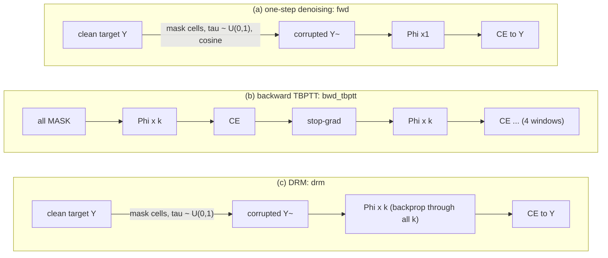
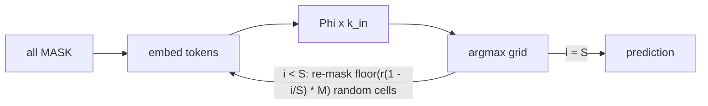
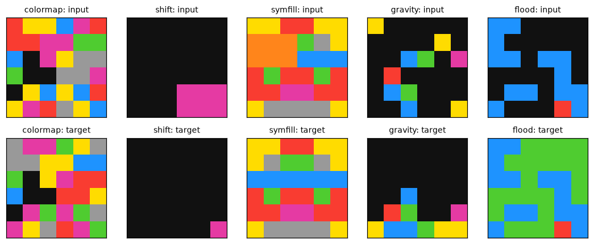
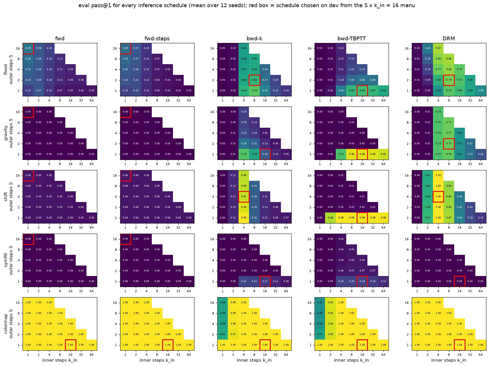
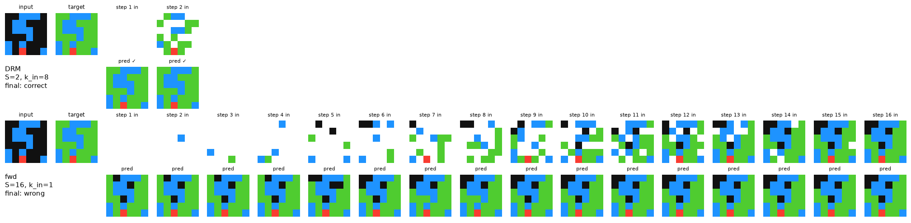
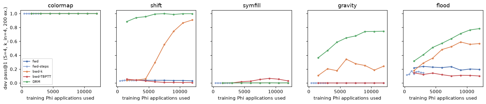
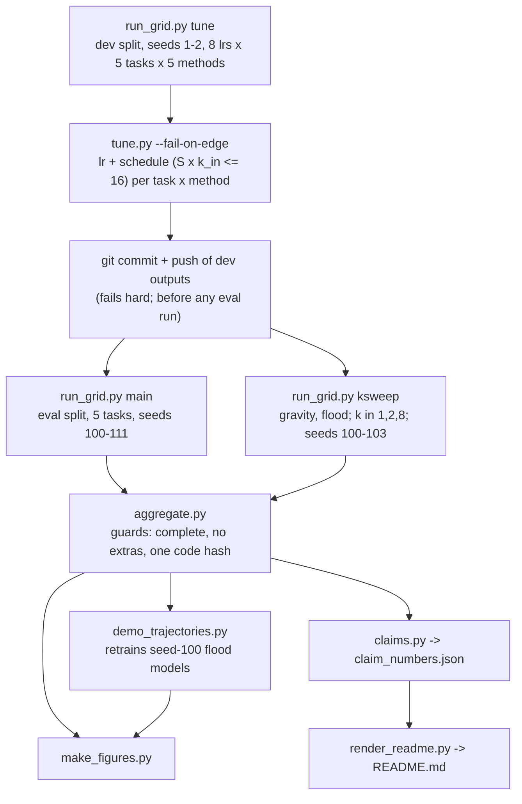

# DRM recursion-curriculum microbench (CPU toy)

A small, CPU-only reproduction of the core idea of **Denoising Recursion Models** (DRM): corrupt the target, then train a shared recursive block to recover it over **k recursive steps** rather than in one jump. It compares DRM with **one-step denoising** (diffusion-style "forward" training) and with **backward recursion from a full mask** (TRM-style TBPTT), all on the same block Phi, at matched parameter count and matched training FLOPs.

> Credit: Cameron, Wang, Ivanov, Bhattacharyya, Chételat and Zhang, *One Step Forward and K Steps Back: Better Reasoning with Denoising Recursion Models*, Huawei Technologies, University of Toronto and University of Waterloo, [arXiv:2604.18839](https://arxiv.org/html/2604.18839v1). Official code: [wwwwwwwwz/DenoisingRecursionModels](https://github.com/wwwwwwwwz/DenoisingRecursionModels). This repo is an independent didactic toy on 6×6 grids. It makes no ARC-AGI or SOTA claim.

## TL;DR

> **Round 2 (after the second review).** The headline now lets every method stop early: the schedule is chosen on dev among all schedules with **at most** 16 test Phi (S·k_in ≤ 16), not exactly 16. Before, the single-window `bwd_k`, trained on 4 steps, was forced to run 16. This was re-tuned from the committed dev runs; only the 8 cells whose lr changed were re-run on eval. **The noise-curriculum result changed** (second bullet). See [Round 2 changes](#round-2-changes).
>
> **Round 3 (after the third review).** No new training runs and no change to any number in the Holm family. The wording changed: the gravity lead over `bwd_k` is **not robust** and the noise curriculum is **not reproduced** (second bullet). The tie-break rule is now documented as it is implemented, and its effect is reported. See [Round 3 changes](#round-3-changes).
>
> **Round 1.** All **5 tasks** × **12 eval seeds** (the round-0 task cut is reverted), an lr grid of 5e-4 … 6.4e-2 for **every** task and method, and pure latent inference up to 64 steps. Round-0 and round-1 artifacts are kept in [results/r0_932be94/](results/r0_932be94/) and [results/r1_c4532b5/](results/r1_c4532b5/).

- **DRM beats one-step denoising, but on 3 of the 5 tasks, not all.** Pooled over all five tasks, pass@1 is 71.1% [69.8, 72.5] for DRM against 29.1% [28.9, 29.3] for the FLOP-matched one-step denoiser (+42.0 pp [+40.6, +43.4], 12/0 seeds won/lost, Holm p = 0.012). The gain comes from shift (+93.6 pp [+93.4, +93.9]), gravity (+76.3 pp [+69.2, +83.3]) and flood (+40.1 pp [+38.3, +41.9]). On colormap every method scores 100%, and on symfill DRM and fwd are both near 0 (0.2% vs 0.2%, +0.0 pp [-0.1, +0.1]).
- **No pooled evidence that the noise curriculum helps.** DRM is the same k = 4 recursion as `bwd_k`, but it starts from a corrupted target instead of a full mask. Once `bwd_k` may stop early (dev picks a 4- or 8-step latent schedule) instead of being forced to 16 steps, the pooled difference is +1.8 pp [-0.6, +4.2] (8/4 seeds won/lost, Holm p = 1). In round 1 it was +10.7 pp [+8.5, +12.9]. Scoring `bwd_k` at its native 4-step schedule (S = 1, k_in = 4, same models) instead gives -0.2 pp [-1.6, +1.2] pooled (raw p = 0.79). The only per-task difference that holds up is symfill, where DRM is **behind**:
  - **Behind on symfill:** -21.4 pp [-24.4, -16.7], Holm p = 0.012 (dev picked the native schedule here, so the two analyses agree).
  - **Gravity, +24.9 pp [+13.5, +35.9] (Holm p = 0.043), is not robust.** It is mostly dev-selection noise (a winner's curse from picking among 120 lr × schedule cells on 2 dev seeds). At the schedule dev picked for `bwd_k` (S = 1, k_in = 8) its 12 eval seeds range from 14.6-86.8% (sd 23.2 pp), so its mean is low and noisy. At its native S = 1, k_in = 4 the same models score 70.8% [70.1, 71.2] (sd 1.1 pp), and DRM's lead shrinks to +5.5 pp [-1.7, +12.9] (7/5 seeds, raw p = 0.18, not significant). DRM is itself noisy on gravity (seeds range 59.3-95.0%).
  - **Flood and shift: not significant after Holm.** Flood is +5.5 pp [+2.1, +8.9] (Holm p = 0.12) and shift +0.1 pp [-0.1, +0.1]. At `bwd_k`'s native 4-step schedule flood is +14.8 pp [+12.4, +17.3], but that pits DRM at its 16-Phi dev pick (S=2, k_in=8) against `bwd_k` at 4 Phi, so it is a compute mismatch, not curriculum evidence. Scored at the **same** schedule, the two are level on flood (+0.3 pp [-3.4, +3.9] at S1/k8, `bwd_k`'s dev pick, 7/5 seeds, raw p = 0.86); that holds at this one schedule only, since the other two flood same-schedule rows range from -12.8 pp [-15.8, -9.9] at S1/k4 to +45.9 pp [+38.6, +52.8] at S2/k8 (Round 4 table below). On gravity with both at S1/k4 DRM is ahead by only +1.7 pp [+0.8, +2.6] (raw p = 0.0059). These same-schedule rows are descriptive and outside the Holm family ([results/same_schedule.json](results/same_schedule.json), [scripts/same_schedule.py](scripts/same_schedule.py)).
- **DRM loses to TRM-style backward TBPTT overall.** Pooled it is 71.1% [69.8, 72.5] against 76.3% [75.1, 77.4] (-5.2 pp [-7.1, -3.2], Holm-significant). DRM is ahead on flood (+10.3 pp [+7.7, +13.2]) and slightly on shift (+1.4 pp [+1.2, +1.7]), and behind on gravity (-19.6 pp [-26.6, -12.7]) and symfill (-18.1 pp [-24.0, -12.0]). TBPTT here gets 4 windows (16 recursive steps) per batch for the same FLOPs.
- **With more test compute, DRM keeps improving on flood and TBPTT does not**, now that both can use their best inference mode at every budget: from 16 to 64 Phi, DRM goes 79.2% → 86.8% (S=16, k_in=4) and latent TBPTT 68.9% → 60.7% (S=1, k_in=64). On gravity both are flat (DRM 77.4%, TBPTT 92.3% at 64 Phi).
- **A train-test-mismatch symptom shows up for one-step denoising**, but this probe does not prove it is the cause. At each method's own dev-best 16-Phi schedule, flood cell accuracy on its own trajectory vs on noised clean targets is 87.0% vs 100.0% for fwd, and 96.9% vs 99.9% for DRM.

All numbers are eval-split pass@1 (whole-grid exact match) over **12 fresh training seeds** (100-111), at **at most** 16 test Phi applications (S·k_in ≤ 16), with the lr and the inference schedule chosen on dev for each (task, method). Intervals are 95% percentile seed-bootstrap CIs (they under-cover a little at n = 12; Student-t intervals are in [results/tables/](results/tables/)). p-values are exact paired sign-flip tests, Holm-corrected over all 24 comparisons. The model has 52,488 parameters, the code hash is `23eb93ba4b532a98` (results computed under `91de577ed2a30aae`, verified output-identical; see [Verification](#verification)), and there are 153 tests with 144/144 planted bugs caught (see [Verification](#verification)). Everything ran on CPU; no GPU was used.


*[figures/primary.png](figures/primary.png): data in [results/summary.json](results/summary.json) (`primary`) and [results/tables/primary.csv](results/tables/primary.csv); script [scripts/make_figures.py](scripts/make_figures.py).*

## What was compared



| id | what | start state | Phi per opt step | opt steps | training Phi |
|---|---|---|---|---|---|
| `fwd` | one-step denoising (paper Eq. 3), **FLOP-matched** | corrupted target | 1 | 12,000 | 12,000 |
| `fwd_steps` | one-step denoising, **step-matched** | corrupted target | 1 | 3,000 | 3,000 |
| `bwd_k` | backward recursion, one window of k = 4 (= DRM with tau = 1) | full mask | 4 | 3,000 | 12,000 |
| `bwd_tbptt` | backward TBPTT, 4 windows × k = 4 with stop-gradient (Eq. 4-5, TRM-style) | full mask | 4 | 3,000 | 12,000 |
| `drm` | **DRM** (Eq. 6), k = 4 | corrupted target | 4 | 3,000 | 12,000 |

Every method uses the same block, initialisation (paired by seed), optimiser and batch size. The learning rate and the inference schedule are tuned **per method on dev**, so each baseline gets its best setting. Details are in [docs/method.md](docs/method.md), and the section-by-section mapping to the paper is in [docs/paper_mapping.md](docs/paper_mapping.md).

**Why local attention.** Phi is one transformer layer whose attention only reaches neighbouring cells (radius 1), so information moves at most one cell per Phi step. That gives each task a known minimum recursion depth (shift: 2; gravity and flood: up to the grid size), and a test checks this. This is a design choice, not an empirical finding: I have no committed evidence that global attention would make the tasks one-step solvable (an earlier version of this README claimed it did; see [docs/pilots.md](docs/pilots.md)).

### Inference: the same for every method



S = 1 is pure latent recursion, which is how a backward-trained model is natively used. Every run is scored on all 25 schedules with S ∈ {1,…,16}, k_in ∈ {1,…,64} and S·k_in ≤ 64, so pure latent recursion (S = 1) is available at every budget up to 64. The headline uses every schedule with **at most** matched compute, S·k_in ≤ 16 (15 schedules), picking the one that is best on dev for each (task, method). Exact dev ties go to the lowest lr first and only then to menu order, where the 16-Phi schedules come first (lr is the outer loop of the search). A method may therefore stop early, e.g. `bwd_k`, trained on one 4-step window, can run 4 latent steps instead of being forced to 16.

## Tasks



*[figures/tasks.png](figures/tasks.png): generated by [drm/tasks.py](drm/tasks.py) through [scripts/make_figures.py](scripts/make_figures.py).*

| task | rule | min. Phi steps (radius-1 attention) |
|---|---|---|
| `colormap` | per-cell colour permutation | 1 |
| `shift` | move objects (+1, +2), no wrap | 2 |
| `symfill` | fill an occluder from the left-right mirror | up to 5 |
| `gravity` | cells fall to the bottom of their column, keeping order | up to 5 |
| `flood` | mark cells 4-connected to the source | path length |

All five tasks are in the eval grid. `colormap` needs no recursion and acts as a sanity check (every method should solve it).

### Round 5 changes

No new runs, and no result, tuning or figure file changed (only `claim_numbers.json` and the mutation tables are regenerated).

- **Claims rebuild test (review r5 m1).** [tests/test_r5.py](tests/test_r5.py) rebuilds every claim from `results/` and requires it to equal the committed [results/claim_numbers.json](results/claim_numbers.json) (full tree only), and checks the same-schedule (`ss_*`) won/lost and S/k labels on a fabricated asymmetric `same_schedule.json`, so a won/lost or S/k swap fails inside the mutation copies too. Both swaps are in the harness, with the two pipeline mutants below (4/4 killed).
- **Wording (n1, n2).** The heatmap sentence below no longer says `bwd_k` always drops past its 4-step window (on flood it is best at S1/k8), and the TL;DR gives the range of the other flood same-schedule rows next to "level".
- **Pipeline order (n3).** A test now requires `pipeline.sh` to run `same_schedule.py` after `aggregate.py` and before `claims.py`.

### Round 4 changes

No new training runs. No existing result, tuning or figure file changed; the one new result file is the descriptive `results/same_schedule.json`. The Holm family and every headline number are unchanged.

- **Flood wording (review r4 m1).** The TL;DR no longer reads the native-schedule flood gap as an effect: `sensitivity.bwd_k_native` moves only `bwd_k`'s schedule, so on flood it compares DRM at 16 Phi with `bwd_k` at 4 Phi. A new descriptive check, [scripts/same_schedule.py](scripts/same_schedule.py) → [results/same_schedule.json](results/same_schedule.json), scores **both** methods at the same schedule with the same tuned lrs and eval runs:

  | task | schedule (whose pick) | DRM − `bwd_k` | seeds won/lost | raw p |
  |---|---|---|---|---|
  | flood | S1/k8 (`bwd_k`'s dev pick) | +0.3 pp [-3.4, +3.9] | 7/5 | 0.86 |
  | flood | S1/k4 (`bwd_k` native) | -12.8 pp [-15.8, -9.9] | 0/12 | 0.00049 |
  | flood | S2/k8 (DRM's dev pick) | +45.9 pp [+38.6, +52.8] | 12/0 | 0.00049 |
  | gravity | S1/k4 (both native) | +1.7 pp [+0.8, +2.6] | 11/1 | 0.0059 |
  | gravity | S1/k8 (both dev picks) | +24.9 pp [+13.5, +35.9] | 9/3 | 0.0039 |

  Which method "wins" depends mostly on which schedule both are scored at: each does best near its own pick. `bwd_k` drops sharply under re-masking (S ≥ 2) and at k_in ≥ 16, but not simply past its 4-step training window: on flood it is best just past it (S1/k8 0.74 vs S1/k4 0.64; S1/k16 0.39, S2/k8 0.33), while on gravity it falls from 0.71 at S1/k4 to 0.51 at S1/k8. This supports the reading below ("not reproduced"). The same pattern is visible in [figures/schedule_heatmaps.png](figures/schedule_heatmaps.png). The other three tasks are in the JSON.
- **Tests for the round-3 code (m2).** [tests/test_r4.py](tests/test_r4.py) pins the sensitivity check's two-sided p, wins/losses, seed sd (ddof = 1) and 5-task pool; that `summary.json` `meta.computed_under` keeps an ancestor hash on regeneration; the claims tie list (colormap excluded) and superseded/round-0 CPU-h (train + eval seconds); that `verify_lineage` exits 1 on a failed check and leaves `code_lineage.json` unchanged; and the default full lineage set on a fabricated tree. The reviewer's P1-P9 are in the harness (9/9 killed).
- **Nits.** `tune.py`'s docstring lists all 6 tie cells (n2). If the dev runs ever carry more than one lineage-linked hash, `tuning.json` lists them all in `meta.computed_under` instead of silently keeping only the canonical one (n4; with one hash, as now, the file is byte-identical). "Total spent" now says it excludes the lineage checks and pilots (n5). n1 (squash vs plain merge) is left to the owner.

### Round 3 changes

- **Gravity vs `bwd_k` reworded (review r3 major 1).** The +24.9 pp [+13.5, +35.9] lead comes from a seed-unstable schedule picked on dev for `bwd_k` (eval seeds range 14.6-86.8%, sd 23.2 pp). At `bwd_k`'s native 4-step schedule it is +5.5 pp [-1.7, +12.9] (7/5, raw p = 0.18). `aggregate.py` now writes this check to `summary.json` (`sensitivity.bwd_k_native`, every task and the pool, outside the Holm family). `tables/primary.csv` gains a seed-sd column.
- **Tie-break documented as implemented (m3).** The docs said ties keep the 16-Phi schedule. In fact lr is the outer loop with a strict `>`, so an exact dev tie goes to the **lowest lr** first and only then to menu order. The code is unchanged; the docs are fixed and a test pins the rule. Exact cross-lr ties on dev occur in 6 non-colormap cells (gravity fwd_steps, shift bwd_k, shift bwd_tbptt, shift drm, symfill bwd_tbptt, symfill fwd_steps). The one that mattered is symfill `bwd_tbptt`: round 1's 3.2e-2 at S1/k16 and 1.6e-2 at S1/k8 both score 0.288 on dev, so the lower lr won and 12 eval runs were redone. Keeping the round-1 runs instead would give symfill TBPTT 20.4% [14.4, 24.5] instead of 18.3% [12.2, 24.2], and pooled DRM − TBPTT -5.6 pp [-6.9, -4.1] instead of -5.2 pp [-7.1, -3.2] (`sensitivity.tie_symfill_tbptt_r1`).
- **Results keep the hash they were computed under (m2).** Regenerating `tuning.json`, `summary.json` or the README at a newer HEAD used to relabel the results with the current code hash. `tune.py` now records the raw runs' hash, and the README's "computed under" hash comes from the raw metas (`summary.json` `meta.computed_under`). A test checks that regenerating `tuning.json` at HEAD is byte-identical.
- **Tests (m4).** New tests in `tests/test_r3.py` kill all five survivors (W2, W3, W4, W7, W10) and W8 and W11. They cover cross-lr tie order, unit tests of the lineage comparison, a CLI collision exiting 2, a cyclic lineage file, and non-dev runs rejected by `tune.py`. W1-W11 and four mutants of my own (W12-W15) are in the harness.
- **Nits.** The round-1 lr-edge list now shows round-1 edges (n2). Total compute spent includes superseded and round-0 runs (n3). `pipeline.sh` runs the hygiene scan before it commits or pushes (n4). The lineage record now holds the static argument and re-runs one full committed run per task plus a k = 1 k-sweep run (n5). n1 (paths in old history) is left to the owner.

### Round 2 changes

- **Headline menu S·k_in ≤ 16 (review major 1).** Rounds 0-1 forced exactly 16 test Phi. That pushed `bwd_k` 4× past its 4-step training window. In round 1, at lr 6.4e-2, its gravity eval pass@1 was 72.9% at S=1, k_in=4 against 28.8% at the forced S=1, k_in=16. tune.py now chooses lr and schedule among all 15 schedules with S·k_in ≤ 16, using the committed dev runs; no new dev runs were needed. The chosen lr changed for 8 cells (flood bwd_k: 0.016 -> 0.008; gravity bwd_k: 0.064 -> 0.004; gravity fwd: 0.0005 -> 0.064; gravity fwd_steps: 0.001 -> 0.002; shift bwd_k: 0.064 -> 0.016; shift fwd_steps: 0.016 -> 0.064; symfill bwd_tbptt: 0.032 -> 0.016; symfill fwd_steps: 0.001 -> 0.004). Only those cells were re-run on eval (96 runs); their round-1 runs are in [results/r1_c4532b5/](results/r1_c4532b5/). Every other cell reuses its round-1 eval runs, with only the scored schedule changing.
- **Commit-before-eval wording and enforcement (m2).** Round 1 dev outputs were committed at 18:18:47 EDT, before eval started, and pushed at 18:19:18, before any eval run finished. They were not "pushed before any eval run". `pipeline.sh` now fails if the commit fails, checks that `results/raw/dev` and `tuning.json` are fully committed, and pushes before launching eval.
- **k-sweep labels (m3).** TBPTT's training horizon is n_sup·k = 4k steps, so the fixed S=1, k_in=16 latent schedule is "native" only at k = 4. The table now has a horizon-matched column (S=1, k_in=4k).
- **Tests (m4).** All 6 surviving mutants of the reviewer's 13 are killed by new tests in `tests/test_r2.py`, and the reviewer's mutants were added to the harness.
- **Run names (m5).** Names now always include the training budget and attention radius (`_b12000_r1_`), and any other non-default field adds a config-hash suffix. `run_one.py` refuses to overwrite an output holding a different config unless `--force` is given, and a negative radius is rejected. The committed dev results were never overwritten in this repo (the reviewer's overwrite happened in a scratch clone). These changes touch hashed files, so the code hash changed. Instead of re-running everything, `scripts/verify_lineage.py` ran configs under both code versions and found every output identical, then recorded the link in [results/code_lineage.json](results/code_lineage.json).
- **Nits:** an `LR_GRID` pointer to the effective 8-point grid (n2), readable schedule labels in the own-schedule mismatch figure (n3), TBPTT's 0 gap noted as by construction (n4), the compute-curve caption saying lr is fixed (n5), and the lower lr edge noted as never extended (n6). n1 (paths in old history) is left to the owner's merge choice; no history was rewritten.

### Round 1 changes

- **All 5 tasks, 12 seeds (M1).** Round 0 dropped colormap and symfill from eval after looking at dev, and justified it with a "3.5× CPU slowdown". The logs show short bursts of slow jobs, not a sustained slowdown, and the two dropped tasks were the ones where DRM did not win on dev. The cut is reverted. The full story is in [docs/method.md](docs/method.md#round-0-scope-cut-reverted).
- **lr grid (M2).** Every (task, method) gets the same grid {5e-4, 1e-3, 2e-3, 4e-3, 8e-3, 1.6e-2, 3.2e-2, 6.4e-2}. The last two points were added on dev evidence, for every cell, before any eval run; 6.4e-2 was declared the last extension. Round-1 cells whose dev optimum was still at an edge: flood:fwd_steps:0.064, gravity:bwd_k:0.064, gravity:fwd:0.0005, shift:bwd_k:0.064 (round-2 edges are under Limitations).
- **Inference (M3).** Pure latent recursion (S = 1) is now offered at 32 and 64 Phi, so at every budget each method uses its dev-best mode (latent or re-masking).
- **Provenance (m4).** Dev outputs and `tuning.json` were committed (3d7f9c4, 18:18:47 EDT) before the first eval run started, and pushed (18:19:18) before any eval run finished. Every raw result records start and end timestamps, load average and wall time.
- **Smaller items:** collision-free run names and input validation (m7), lock file and no hard-coded interpreter (m5), softened pilot claim (m6), DRM shown next to fwd in the mismatch probe (m1), corrected CPU-hours (m2), more mutants (m3), and the nits. See the PR thread for a per-item list.

## Results (eval split)

| task | DRM | bwd-TBPTT | bwd-k | fwd (FLOP-matched) | fwd (step-matched) |
|---|---|---|---|---|---|
| colormap | 100.0% [100.0, 100.0] | 100.0% [100.0, 100.0] | 100.0% [100.0, 100.0] | 100.0% [100.0, 100.0] | 100.0% [100.0, 100.0] |
| shift | 99.9% [99.8, 100.0] | 98.5% [98.2, 98.7] | 99.9% [99.8, 99.9] | 6.3% [6.0, 6.5] | 5.5% [5.2, 5.8] |
| symfill | 0.2% [0.2, 0.3] | 18.3% [12.2, 24.2] | 21.7% [16.9, 24.6] | 0.2% [0.1, 0.3] | 0.2% [0.2, 0.3] |
| gravity | 76.3% [69.2, 83.4] | 95.9% [95.6, 96.3] | 51.4% [39.2, 64.1] | 0.0% [0.0, 0.1] | 0.1% [0.0, 0.1] |
| flood | 79.2% [77.3, 81.2] | 68.9% [66.5, 71.4] | 73.7% [70.7, 76.8] | 39.1% [38.2, 40.1] | 35.4% [34.6, 36.2] |
| **pooled, all 5 (primary)** | **71.1% [69.8, 72.5]** | 76.3% [75.1, 77.4] | 69.3% [66.3, 72.2] | 29.1% [28.9, 29.3] | 28.2% [28.1, 28.4] |
| pooled3: shift, gravity, flood (descriptive) | 85.1% [82.9, 87.4] | 87.8% [87.0, 88.6] | 75.0% [70.5, 79.5] | 15.1% [14.8, 15.5] | 13.7% [13.3, 14.0] |

Dev-chosen settings (lr; schedule):

| task | DRM | bwd-TBPTT | bwd-k | fwd | fwd-steps |
|---|---|---|---|---|---|
| colormap | 0.0005; S=1, k_in=16 | 0.0005; S=1, k_in=16 | 0.0005; S=1, k_in=16 | 0.0005; S=1, k_in=16 | 0.0005; S=1, k_in=16 |
| shift | 0.016; S=4, k_in=4 | 0.002; S=1, k_in=16 | 0.016; S=1, k_in=4 | 0.032; S=16, k_in=1 | 0.064; S=2, k_in=1 |
| symfill | 0.032; S=1, k_in=16 | 0.016; S=1, k_in=8 | 0.004; S=1, k_in=4 | 0.016; S=16, k_in=1 | 0.004; S=4, k_in=1 |
| gravity | 0.032; S=1, k_in=8 | 0.004; S=1, k_in=8 | 0.004; S=1, k_in=8 | 0.064; S=4, k_in=1 | 0.002; S=8, k_in=1 |
| flood | 0.008; S=2, k_in=8 | 0.002; S=1, k_in=16 | 0.008; S=1, k_in=8 | 0.004; S=16, k_in=1 | 0.064; S=16, k_in=1 |

On colormap every setting reaches 100% on dev, so the tie-break (first lr in grid order) picks 5e-4 for everyone.

### DRM minus each baseline (paired by seed)

| | vs fwd (FLOP) | vs fwd (steps) | vs bwd-k | vs bwd-TBPTT |
|---|---|---|---|---|
| colormap | +0.0 pp [+0.0, +0.0] (p_H=1) | +0.0 pp [+0.0, +0.0] (p_H=1) | +0.0 pp [+0.0, +0.0] (p_H=1) | +0.0 pp [+0.0, +0.0] (p_H=1) |
| shift | +93.6 pp [+93.4, +93.9] (p_H=0.012) | +94.4 pp [+94.2, +94.7] (p_H=0.012) | +0.1 pp [-0.1, +0.1] (p_H=1) | +1.4 pp [+1.2, +1.7] (p_H=0.012) |
| symfill | +0.0 pp [-0.1, +0.1] (p_H=1) | -0.0 pp [-0.1, +0.1] (p_H=1) | -21.4 pp [-24.4, -16.7] (p_H=0.012) | -18.1 pp [-24.0, -12.0] (p_H=0.043) |
| gravity | +76.3 pp [+69.2, +83.3] (p_H=0.012) | +76.2 pp [+69.2, +83.3] (p_H=0.012) | +24.9 pp [+13.5, +35.9] (p_H=0.043) | -19.6 pp [-26.6, -12.7] (p_H=0.012) |
| flood | +40.1 pp [+38.3, +41.9] (p_H=0.012) | +43.8 pp [+41.8, +45.8] (p_H=0.012) | +5.5 pp [+2.1, +8.9] (p_H=0.12) | +10.3 pp [+7.7, +13.2] (p_H=0.012) |
| **pooled** | +42.0 pp [+40.6, +43.4] (p_H=0.012) | +42.9 pp [+41.5, +44.3] (p_H=0.012) | +1.8 pp [-0.6, +4.2] (p_H=1) | -5.2 pp [-7.1, -3.2] (p_H=0.023) |

15 of 24 comparisons are significant after Holm (p_H < 0.05). With 12 seeds the smallest attainable raw p is 2/4096. On colormap every difference is exactly 0 (p = 1).

![Forest plot of DRM minus each baseline in eval pass@1, with 95% seed-bootstrap CIs for all five tasks and the pooled mean. Pooled: vs fwd +42.0 pp [+40.6, +43.4], vs bwd-k +1.8 pp [-0.6, +4.2], vs bwd-TBPTT -5.2 pp [-7.1, -3.2]. Filled markers are Holm-significant.](figures/forest.png)

*[figures/forest.png](figures/forest.png): data in [results/summary.json](results/summary.json) (`tests`) and [results/tables/tests.csv](results/tables/tests.csv); script [scripts/make_figures.py](scripts/make_figures.py).*

**Round 0 vs round 1 (pooled, DRM minus baseline).** Round 0 pooled only shift, gravity and flood with 10 seeds and a narrower lr grid: vs fwd +67.4 pp [+65.0, +69.7], vs bwd-k +42.2 pp [+37.8, +46.6], vs bwd-TBPTT -5.5 pp [-7.8, -3.4]. The comparable round-1 number is pooled3 above; the primary round-1 number is the 5-task pool.

**Round 1 vs round 2 (≤ 16-Phi menu).** Pooled pass@1 for `bwd_k` went from 60.5% [58.4, 62.6] to 69.3% [66.3, 72.2], so DRM − bwd-k went from +10.7 pp [+8.5, +12.9] to +1.8 pp [-0.6, +4.2]. The other comparisons barely moved: DRM − fwd went +42.1 pp [+40.6, +43.5] → +42.0 pp [+40.6, +43.4], and DRM − TBPTT went -5.5 pp [-6.8, -4.0] → -5.2 pp [-7.1, -3.2]. Comparisons significant after Holm: 17 → 15 of 24.

## pass@1 vs test-time compute


*[figures/compute_curves.png](figures/compute_curves.png): data in [results/summary.json](results/summary.json) (`compute_curves`, which also records the schedule used at each point). The schedule per compute level was chosen on dev ([results/tuning.json](results/tuning.json), `by_compute`); **the lr is fixed at each cell's headline (≤ 16 Phi) dev choice and is not re-tuned per budget**.*



*[figures/schedule_heatmaps.png](figures/schedule_heatmaps.png): data in [results/summary.json](results/summary.json) (`schedules`); script [scripts/make_figures.py](scripts/make_figures.py).*

What the compute curves and heatmaps show (each point uses the dev-best schedule at that budget, latent or re-masking):

- **One-step denoising does not use extra test compute.** On flood it peaks at 39.1% at 16 Phi and falls to 19.3% at 64; on gravity and symfill it is near 0 at every budget, and on shift it stays at about 6.3%.
- **DRM keeps improving past the matched budget on flood**, 79.2% at 16 Phi to 84.2% at 32 and 86.8% at 64, using re-masking schedules. On gravity it is flat (76.8% → 77.4%).
- **Backward-trained models are best with latent recursion near their training horizon.** TBPTT now gets pure latent recursion at every budget and the dev picks it every time (S = 1). Going past 16 latent steps it slowly loses accuracy: flood 68.9% → 66.8% → 60.7%, gravity 95.8% → 92.3%. In round 0 the grid capped latent recursion at 16 steps, which forced TBPTT into re-masking above 16 Phi and made it look as if it collapsed; that was an artifact of the grid (review M3). The single-window `bwd_k` degrades faster (gravity 15.9% at 16 Phi, 3.0% at 64).
- **DRM does well whenever k_in ≥ 4**, its training window, at almost any S, and fails with k_in ≤ 2 (heatmaps).

## Train-test mismatch probe

Under the masking process, every **visible** cell a denoiser sees in training is correct. At test time, the visible cells are its own earlier guesses. The probe compares, at each outer step, accuracy along the model's own trajectory with accuracy when the same step's input is the training distribution (the clean target masked at the same level, the "oracle" input). It also measures how many wrong visible cells each model fixes.


*[figures/mismatch.png](figures/mismatch.png): data in [results/summary.json](results/summary.json) (`traces.flood.*.S16_k1`), recorded by [scripts/run_one.py](scripts/run_one.py); script [scripts/make_figures.py](scripts/make_figures.py).*


*[figures/mismatch_own_schedule.png](figures/mismatch_own_schedule.png): data in [results/summary.json](results/summary.json) (`traces_at_choice`); script [scripts/make_figures.py](scripts/make_figures.py).*

| at S = 16, k_in = 1, last step: own / oracle cell acc. (self-correction) | fwd | DRM | bwd-TBPTT |
|---|---|---|---|
| shift | 89.5 / 100.0 (0.0%) | 45.3 / 56.6 (0.0%) | 53.7 / 49.7 (16.1%) |
| symfill | 87.9 / 100.0 (0.0%) | 87.9 / 100.0 (0.0%) | 82.1 / 80.5 (21.1%) |
| gravity | 82.6 / 100.0 (0.0%) | 77.0 / 93.7 (0.1%) | 72.4 / 72.0 (16.7%) |
| flood | 87.0 / 100.0 (0.1%) | 70.3 / 96.8 (4.3%) | 69.8 / 70.3 (39.5%) |

How to read the probe:

- **At the same schedule (S = 16, k_in = 1, the table above)** both DRM and fwd do better on noised clean targets than on their own states, and the gap is about as large for DRM as for fwd (larger on flood: DRM 70.3% vs 96.8%, fwd 87.0% vs 100.0%). This schedule is fwd's own dev choice but a poor one for DRM, and near the end of it the oracle input is almost all clean visible cells, so a high oracle number partly measures copying. At this schedule the probe does not single out one-step denoising.
- **At each method's own dev-best 16-Phi schedule** ([mismatch_own_schedule.png](figures/mismatch_own_schedule.png); traces are recorded only for 16-Phi schedules, so this can differ from the headline schedule) the own-vs-oracle gap at the last step is +13.0 pp for fwd against +3.0 pp for DRM on flood, +18.4 vs +0.3 pp on gravity, and +10.5 vs +0.0 pp on shift. TBPTT's own schedule is S = 1, which has no visible tokens and no re-masking, so its own and oracle inputs are the same full mask and its gap (+0.0 pp) is **0 by construction**, not a finding. fwd and DRM are also compared at the last step of different schedules (fwd S=16, k_in=1, DRM S=2, k_in=8 on flood), which means different mask levels.
- **Self-correction** of wrong visible cells is low for every denoiser (fwd 0.1%, DRM 4.3% on flood at S = 16, k_in = 1). DRM's advantage therefore does not come from fixing visible tokens; it is consistent with the k latent steps inside each denoising step (paper §6), but this toy does not isolate that either.
- **Bottom line:** the symptom the paper describes (a one-step denoiser does worse on its own states than on training-distribution states) is present and is larger for fwd than for DRM at their own schedules. This is consistent with paper §1 and §3.1.1. It is a correlation within this probe, not a causal test.



*[figures/trajectory.png](figures/trajectory.png): data in [results/demo/trajectories.json](results/demo/trajectories.json), from [scripts/demo_trajectories.py](scripts/demo_trajectories.py), which retrains the seed-100 flood models and asserts that they reproduce the main-grid pass@1 to within 1e-6 (the tolerance was loosened from 1e-9 in round 0 because the main grid stores a float32 mean). The example is the first of 6 recorded eval examples where DRM ends correct and fwd ends wrong: illustrative, not typical.*

## Training timelines and the k sweep



*[figures/learning_curves.png](figures/learning_curves.png): data in [results/summary.json](results/summary.json) (`learning_curves`), logged on **dev** examples only during training ([drm/train.py](drm/train.py)).*

![Eval pass@1 on gravity and flood against the training recursion window k in {1, 2, 4, 8} at a fixed 12,000-Phi training budget, for DRM and bwd-TBPTT, at S=16/k, k_in=k (solid), at fixed latent S=1, k_in=16 (dotted), and for TBPTT at its horizon-matched latent S=1, k_in=4k (dashed). Flood DRM native: k=1 39.3% [37.8, 41.0], k=4 75.5% [73.4, 77.6], k=8 76.0% [74.0, 78.0].](figures/ksweep.png)

*[figures/ksweep.png](figures/ksweep.png): data in [results/summary.json](results/summary.json) (`ksweep`), 4 eval seeds (100-103); script [scripts/make_figures.py](scripts/make_figures.py).*

| k | flood DRM native (S=16/k, k_in=k) | flood TBPTT horizon latent (S=1, k_in=4k) | flood TBPTT fixed latent (S=1, k_in=16) | gravity DRM native | gravity TBPTT horizon latent | gravity TBPTT fixed latent |
|---|---|---|---|---|---|---|
| 1 | 39.3% [37.8, 41.0] | 44.2% [41.9, 46.4] | 49.9% [44.5, 55.5] | 0.0% [0.0, 0.1] | 29.1% [21.2, 37.0] | 7.2% [2.6, 12.4] |
| 2 | 65.5% [64.0, 66.9] | 66.2% [62.1, 70.8] | 67.4% [62.1, 72.4] | 1.7% [1.6, 1.8] | 81.0% [77.2, 85.8] | 53.3% [35.1, 75.1] |
| 4 | 75.5% [73.4, 77.6] | 71.7% [68.1, 75.3] | 71.7% [68.1, 75.3] | 73.3% [72.8, 73.6] | 95.9% [95.5, 96.4] | 95.9% [95.5, 96.4] |
| 8 | 76.0% [74.0, 78.0] | 57.8% [52.1, 62.0] | 59.8% [54.6, 63.3] | 99.1% [98.8, 99.3] | 81.7% [76.5, 89.7] | 84.7% [80.1, 91.5] |

At a fixed 12,000-Phi training budget, DRM at its native schedule (S = 16/k, k_in = k) improves steeply from k = 1, which *is* one-step denoising, to k = 4. On flood it then plateaus (75.5% [73.4, 77.6] at k = 4, 76.0% [74.0, 78.0] at k = 8). On gravity it keeps rising to 99.1% [98.8, 99.3] at k = 8, above TBPTT's best value (95.9% [95.5, 96.4] at k = 4). TBPTT is trained on n_sup·k = 4k latent steps from a full mask, so its schedule matched to that horizon is S = 1, k_in = 4k (fixed by the config, not chosen post hoc). The fixed S = 1, k_in = 16 schedule matches only at k = 4 and understates TBPTT at small k (gravity k = 2: 81.0% [77.2, 85.8] at its horizon vs 53.3% [35.1, 75.1] at 16). On both schedules TBPTT peaks at k = 4 and drops at k = 8. So DRM gains more from a larger k than TBPTT does here, in line with the paper's Table 5. The gravity k = 8 result suggests that the k = 4 DRM in the main grid is not DRM's best configuration on gravity, but k was fixed at 4 for every method before the run. The sweep is exploratory: 4 seeds, not in the Holm family, and **the k ≠ 4 runs reuse the lr tuned at k = 4**.

## How this maps to the paper (§3)

| paper claim (§3, §5, App. F) | this toy |
|---|---|
| Forward (one-step) training misaligns train and test, which causes compounding and greedy errors (§1, §3.1.1) | **Consistent: symptom observed, cause not isolated.** At their own schedules, fwd's own-vs-oracle gap is larger than DRM's (flood +13.0 vs +3.0 pp); at a shared S = 16, k_in = 1 schedule it is not. DRM beats fwd by +42.0 pp [+40.6, +43.4] pooled, from the three tasks that need depth. |
| Masked diffusion without recursion fails badly (Table 1: about 0%) | Consistent: `fwd` reaches 0.0% on gravity, 0.2% on symfill and 6.3% on shift. |
| DRM's noise curriculum helps compared with recursion from noise without it (§3.2, §6) | **Not reproduced.** Against `bwd_k` with its schedule chosen among ≤ 16 Phi: +1.8 pp [-0.6, +4.2] pooled, n.s.; at `bwd_k`'s native 4-step schedule: -0.2 pp [-1.6, +1.2]. The only robust per-task difference is symfill, where DRM is behind (-21.4 pp [-24.4, -16.7]). Gravity (+24.9 pp [+13.5, +35.9] under the protocol) falls to +5.5 pp [-1.7, +12.9], n.s., at the native schedule, so it reflects dev-selection noise and is not evidence for the curriculum. The round-1 "+10.7 pp" depended on forcing `bwd_k` 4× past its training window (review r2). |
| DRM beats TRM (Table 1) | **Not reproduced.** DRM wins flood and (by little) shift, but loses gravity, symfill and the pooled mean to TBPTT (-5.2 pp [-7.1, -3.2]). There is no scratchpad, warm-up loop or halting here, and TBPTT gets 4 windows per batch; the paper's App. F.8 also reports TRM ahead on Sudoku. |
| DRM gains more per recursive step k than TRM (Table 5) | See the k-sweep table above; exploratory, 4 seeds, lr not re-tuned per k. |
| DRM uses extra test-time compute well | Consistent on flood (DRM rises to 86.8% at 64 Phi while latent TBPTT drifts down to 60.7%); flat on gravity. |

See [docs/paper_mapping.md](docs/paper_mapping.md) for the equation-by-equation mapping and for the simplifications. None of the following are used, for any method: scratchpad z, warm-up loops, Q-head and halting, EMA, task embedding, augmentation and voting, or SPRM.

## Pipeline and reproduction



```bash
python -m venv .venv && . .venv/bin/activate
pip install --index-url https://download.pytorch.org/whl/cpu torch==2.14.1
pip install -r requirements.lock           # exact versions of every package (pip freeze of the run env)
python -m pytest -q tests                  # about 30 s; uses tiny configs
WORKERS=7 sh scripts/pipeline.sh            # whole chain incl. demo, figures, claims, README; skips up-to-date runs
python scripts/mutation_check.py --workers 2
```

`pipeline.sh` uses `$PY` (default `python`) and runs each stage to completion before the next. `tune.py --fail-on-edge` stops it if a chosen lr sits at an end of the grid; `tune.py` and `aggregate.py` exit 2 on an incomplete, stale, extra-file or mixed-code grid. Python 3.13.5, torch 2.14.1+cpu; [requirements.lock](requirements.lock) pins the transitive packages that PNG bytes depend on (pillow, fonttools, kiwisolver, contourpy).

**Compute used (CPU only, no GPU).** The single-threaded runs behind the current results sum to **43.3 CPU-hours** of training plus evaluation: dev tuning 21.2 h, eval grid 18.5 h, k-sweep 3.5 h (from `train_seconds` + `eval_seconds` in the raw metas). With 7 workers on an 8-core box this was spread over 2026-10-28 15:07 to 2026-10-28 23:39 EDT, including interruptions. A DRM run trains in about 159 s on one core. Kaggle GPU access was available but not used, so every result in this repo comes from the same CPU environment. **Total spent** also includes the 96 round-1 eval runs that round 2 superseded (5.5 h, [results/r1_c4532b5/](results/r1_c4532b5/)): ≈48.8 CPU-hours for rounds 1-2, plus 24.3 h for round 0's 354 runs ([results/r0_932be94/](results/r0_932be94/)). These totals **exclude** the lineage-verification runs (short configs run under both code versions plus a few full re-runs, in rounds 2 and 3; their outputs were not kept) and the pilots in [docs/pilots.md](docs/pilots.md).

## Verification

- **153 tests** cover the pipeline wiring end to end, not just helpers. Examples: training Phi counts and budgets per method; DRM and fwd starting from corrupted targets while bwd starts from a full mask; TBPTT detaching between windows; zero_grad before every backward; loss targets being clean labels; the remask schedule and the per-seed inference generator; eval metrics using the eval split while the learning curve uses dev; the main grid using tuned lrs, all 5 tasks and all 12 eval seeds; tuning choosing only among schedules with at most 16 Phi, sending exact ties to the lowest lr and then to menu order, and flagging both lr edges; tuning.json and the README keeping the code hash the results were computed under after a regeneration at a newer HEAD; the lineage comparison detecting any output change; collision-free run names that include budget and radius, refusal to overwrite a different config, and input validation; checkpoints that reproduce the stored pass@1; the 95% CI width; aggregation pairing by seed, applying one Holm family, and refusing partial, extra or stale grids; significance decided by Holm-adjusted p; CPU-hours from train + eval seconds; start time taken before training; a distinct inference generator per schedule; `pipeline.sh` committing and pushing all dev outputs before eval with no ignored failure; a k-sweep horizon fixed by the config; the code-hash lineage; and no machine paths or token-like strings in the repo.
- **Mutation check** ([scripts/mutation_check.py](scripts/mutation_check.py), [results/mutation.csv](results/mutation.csv)): an unmutated control run must pass first, and a mutant counts as killed only when pytest exits 1. **144/144 killed**, including the reviewer's round-1 mutants (15/15), round-2 mutants (14/14) round-3 mutants plus mine for the round-3 code (15/15) round-4 mutants of the round-3 code (9/9) and round-5 mutants of the claims formatting and pipeline order (4/4), 14 mutants of the round-1 code (14/14) and 10 of the round-2 code (10/10). The README-sync test skips inside mutation copies (they have no `results/`), so README drift is checked only in the full tree.
- **Provenance:** every raw result stores the code hash, its config hash, ISO start/end timestamps, load average and wall time. Round 1: dev outputs and `tuning.json` were committed (3d7f9c4) at 18:18:47 EDT, before the first eval run started, and pushed at 18:19:18, before any eval run finished. Round 2: the re-tuned `tuning.json` was committed and pushed (26afcd8, 22:51:08) before the 96 new eval runs started.
- **Code-hash lineage.** All results were computed under code hash `91de577ed2a30aae`. The round-2 m5 fix (run names, overwrite guard, radius check, a comment) changed hashed files, so the current hash is `23eb93ba4b532a98`. [scripts/verify_lineage.py](scripts/verify_lineage.py) checked out the parent commit with `git worktree` and ran the same short configs under both versions: every method × 2 tasks × radius {1, 0} × k {2, 4}, scored on all 25 schedules. It also re-ran full committed runs under the new code: one DRM eval run per task, a k = 1 k-sweep run and dev runs. Every output was identical except timing fields (evidence in [results/code_lineage.json](results/code_lineage.json)). The empirical check is a sample, not a proof. It is enough here because of a static argument, recorded in the lineage file and [docs/method.md](docs/method.md): the diff touches only naming, validation, the overwrite guard and hash acceptance; every RNG derives from config fields (seed, data_seed, S, k), never from run names; and the pipeline never reads checkpoints back. `tune.py`, `aggregate.py` and `run_one.py` accept a hash only through such a verified link, and the results keep the hash they were computed under (`tuning.json` `meta.code_hash`, `summary.json` `meta.computed_under`) even when regenerated at a newer HEAD. Any further code change breaks the chain until it is verified again. Training is deterministic per seed; the trajectory demo retrains two models and checks them against the grid.

## Limitations

- This is a toy: 6×6 grids, about 52k parameters, one model per task, no augmentation. Effects here say nothing direct about ARC-AGI.
- The lr is chosen from 2 dev seeds, and at lr ≥ 1.6e-2 some runs diverge, so the choice is noisy. Cells still at a grid edge after the last extension: flood:fwd_steps:0.064, gravity:fwd:0.064, shift:fwd_steps:0.064. These are one-step denoisers, near 0% on gravity and about 5% on shift at every lr. The grid was only ever extended upward; round 1's one lower-edge cell (gravity fwd at 5e-4) was never extended downward.
- The k-sweep reuses the k = 4 lr for every k and has 4 seeds.
- The seed is the replication unit. CIs resample seeds only, and the 1,000 eval examples are shared across seeds. The percentile bootstrap under-covers somewhat at 12 seeds; t-intervals are in the tables.
- Inference uses evenly spaced remask levels and uniform remasking, with no confidence-based remasking.
- No LICENSE file yet; that is the repository owner's decision.
