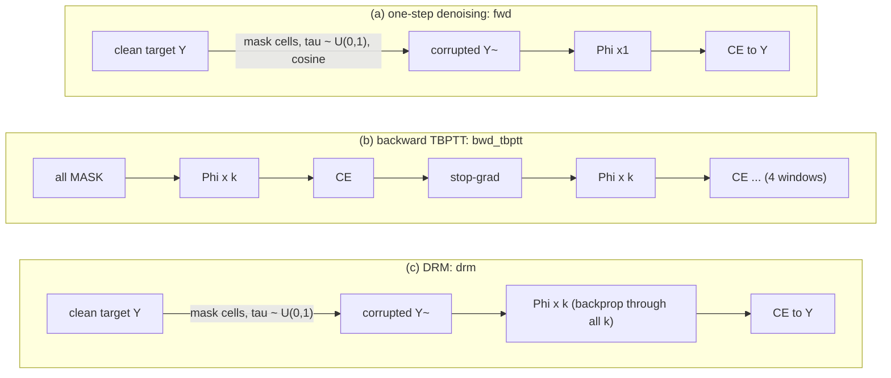
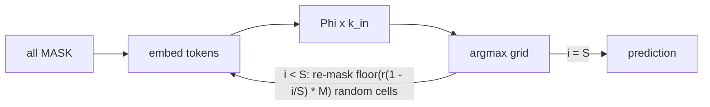
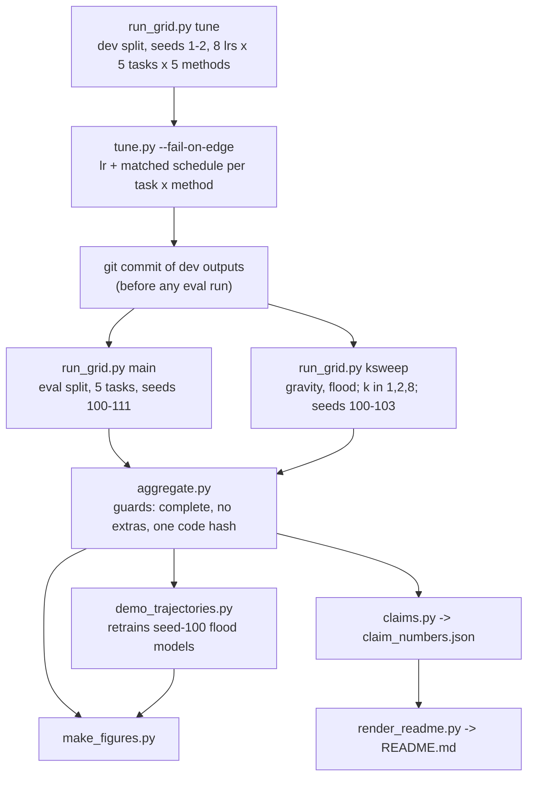

# DRM recursion-curriculum microbench (CPU toy)

A small, CPU-only reproduction of the core idea of **Denoising Recursion Models** (DRM): corrupt the target, then train a shared recursive block to recover it over **k recursive steps** rather than in one jump. It compares DRM with **one-step denoising** (diffusion-style "forward" training) and with **backward recursion from a full mask** (TRM-style TBPTT), all on the same block Phi, at matched parameter count and matched training FLOPs.

> Credit: Cameron, Wang, Ivanov, Bhattacharyya, Chételat and Zhang, *One Step Forward and K Steps Back: Better Reasoning with Denoising Recursion Models*, Huawei Technologies, University of Toronto and University of Waterloo, [arXiv:2604.18839](https://arxiv.org/html/2604.18839v1). Official code: [wwwwwwwwz/DenoisingRecursionModels](https://github.com/wwwwwwwwz/DenoisingRecursionModels). This repo is an independent didactic toy on 6×6 grids. It makes no ARC-AGI or SOTA claim.

## TL;DR

> **Round 1 (after review).** The whole pipeline was rerun under a new code hash: all **5 tasks** × **{{n_eval_seeds}} eval seeds** (the round-0 task cut is reverted), an lr grid of 5e-4 … 6.4e-2 for **every** task and method, and pure latent inference up to 64 steps. Round-0 artifacts are kept in [results/r0_932be94/](results/r0_932be94/). What changed is summarised in [Round 1 changes](#round-1-changes).

{{TLDR}}

All numbers are eval-split pass@1 (whole-grid exact match) over **{{n_eval_seeds}} fresh training seeds** (100-111), at a matched test compute of 16 Phi applications, with the lr and the inference schedule chosen on dev for each (task, method). Intervals are 95% percentile seed-bootstrap CIs (they under-cover a little at n = {{n_eval_seeds}}; Student-t intervals are in [results/tables/](results/tables/)). p-values are exact paired sign-flip tests, Holm-corrected over all {{holm_m}} comparisons. The model has {{n_params}} parameters, the code hash is `{{code_hash}}`, and there are {{n_tests}} tests with {{mut_killed}}/{{mut_total}} planted bugs caught (see [Verification](#verification)). Everything ran on CPU; no GPU was used.


*[figures/primary.png](figures/primary.png): data in [results/summary.json](results/summary.json) (`primary`) and [results/tables/primary.csv](results/tables/primary.csv); script [scripts/make_figures.py](scripts/make_figures.py).*

## What was compared



| id | what | start state | Phi per opt step | opt steps | training Phi |
|---|---|---|---|---|---|
| `fwd` | one-step denoising (paper Eq. 3), **FLOP-matched** | corrupted target | 1 | 12,000 | 12,000 |
| `fwd_steps` | one-step denoising, **step-matched** | corrupted target | 1 | 3,000 | 3,000 |
| `bwd_k` | backward recursion, one window of k = 4 (= DRM with tau = 1) | full mask | 4 | 3,000 | 12,000 |
| `bwd_tbptt` | backward TBPTT, 4 windows × k = 4 with stop-gradient (Eq. 4-5, TRM-style) | full mask | 4 | 3,000 | 12,000 |
| `drm` | **DRM** (Eq. 6), k = 4 | corrupted target | 4 | 3,000 | 12,000 |

Every method uses the same block, initialisation (paired by seed), optimiser and batch size. The learning rate and the inference schedule are tuned **per method on dev**, so each baseline gets its best setting. Details are in [docs/method.md](docs/method.md), and the section-by-section mapping to the paper is in [docs/paper_mapping.md](docs/paper_mapping.md).

**Why local attention.** Phi is one transformer layer whose attention only reaches neighbouring cells (radius 1), so information moves at most one cell per Phi step. That gives each task a known minimum recursion depth (shift: 2; gravity and flood: up to the grid size), and a test checks this. This is a design choice, not an empirical finding: I have no committed evidence that global attention would make the tasks one-step solvable (an earlier version of this README claimed it did; see [docs/pilots.md](docs/pilots.md)).

### Inference: the same for every method



S = 1 is pure latent recursion, which is how a backward-trained model is natively used. Every run is scored on all 25 schedules with S ∈ {1,…,16}, k_in ∈ {1,…,64} and S·k_in ≤ 64, so pure latent recursion (S = 1) is available at every budget up to 64. The headline uses the matched-compute menu S·k_in = 16, picking the schedule that is best on dev for each (task, method).

## Tasks


*[figures/tasks.png](figures/tasks.png): generated by [drm/tasks.py](drm/tasks.py) through [scripts/make_figures.py](scripts/make_figures.py).*

| task | rule | min. Phi steps (radius-1 attention) |
|---|---|---|
| `colormap` | per-cell colour permutation | 1 |
| `shift` | move objects (+1, +2), no wrap | 2 |
| `symfill` | fill an occluder from the left-right mirror | up to 5 |
| `gravity` | cells fall to the bottom of their column, keeping order | up to 5 |
| `flood` | mark cells 4-connected to the source | path length |

All five tasks are in the eval grid. `colormap` needs no recursion and acts as a sanity check (every method should solve it).

### Round 1 changes

- **All 5 tasks, 12 seeds (M1).** Round 0 dropped colormap and symfill from eval after looking at dev, and justified it with a "3.5× CPU slowdown". The logs show short bursts of slow jobs, not a sustained slowdown, and the two dropped tasks were the ones where DRM did not win on dev. The cut is reverted. The full story is in [docs/method.md](docs/method.md#round-0-scope-cut-reverted).
- **lr grid (M2).** Every (task, method) gets the same grid {5e-4, 1e-3, 2e-3, 4e-3, 8e-3, 1.6e-2, 3.2e-2, 6.4e-2}. The last two points were added on dev evidence, for every cell, before any eval run; 6.4e-2 was declared the last extension. Cells whose dev optimum is still at an edge: {{lr_edges}}.
- **Inference (M3).** Pure latent recursion (S = 1) is now offered at 32 and 64 Phi, so at every budget each method uses its dev-best mode (latent or re-masking).
- **Provenance (m4).** Dev outputs and `tuning.json` were committed (3d7f9c4, 18:18 EDT) and pushed before any eval run, and every raw result records start and end timestamps, load average and wall time.
- **Smaller items:** collision-free run names and input validation (m7), lock file and no hard-coded interpreter (m5), softened pilot claim (m6), DRM shown next to fwd in the mismatch probe (m1), corrected CPU-hours (m2), more mutants (m3), and the nits. See the PR thread for a per-item list.

## Results (eval split)

| task | DRM | bwd-TBPTT | bwd-k | fwd (FLOP-matched) | fwd (step-matched) |
|---|---|---|---|---|---|
| colormap | {{p1_colormap_drm}} | {{p1_colormap_bwd_tbptt}} | {{p1_colormap_bwd_k}} | {{p1_colormap_fwd}} | {{p1_colormap_fwd_steps}} |
| shift | {{p1_shift_drm}} | {{p1_shift_bwd_tbptt}} | {{p1_shift_bwd_k}} | {{p1_shift_fwd}} | {{p1_shift_fwd_steps}} |
| symfill | {{p1_symfill_drm}} | {{p1_symfill_bwd_tbptt}} | {{p1_symfill_bwd_k}} | {{p1_symfill_fwd}} | {{p1_symfill_fwd_steps}} |
| gravity | {{p1_gravity_drm}} | {{p1_gravity_bwd_tbptt}} | {{p1_gravity_bwd_k}} | {{p1_gravity_fwd}} | {{p1_gravity_fwd_steps}} |
| flood | {{p1_flood_drm}} | {{p1_flood_bwd_tbptt}} | {{p1_flood_bwd_k}} | {{p1_flood_fwd}} | {{p1_flood_fwd_steps}} |
| **pooled, all 5 (primary)** | **{{p1_pooled_drm}}** | {{p1_pooled_bwd_tbptt}} | {{p1_pooled_bwd_k}} | {{p1_pooled_fwd}} | {{p1_pooled_fwd_steps}} |
| pooled3: shift, gravity, flood (descriptive) | {{p1_pooled3_drm}} | {{p1_pooled3_bwd_tbptt}} | {{p1_pooled3_bwd_k}} | {{p1_pooled3_fwd}} | {{p1_pooled3_fwd_steps}} |

Dev-chosen settings (lr; schedule):

| task | DRM | bwd-TBPTT | bwd-k | fwd | fwd-steps |
|---|---|---|---|---|---|
| colormap | {{lr_colormap_drm}}; {{sched_colormap_drm}} | {{lr_colormap_bwd_tbptt}}; {{sched_colormap_bwd_tbptt}} | {{lr_colormap_bwd_k}}; {{sched_colormap_bwd_k}} | {{lr_colormap_fwd}}; {{sched_colormap_fwd}} | {{lr_colormap_fwd_steps}}; {{sched_colormap_fwd_steps}} |
| shift | {{lr_shift_drm}}; {{sched_shift_drm}} | {{lr_shift_bwd_tbptt}}; {{sched_shift_bwd_tbptt}} | {{lr_shift_bwd_k}}; {{sched_shift_bwd_k}} | {{lr_shift_fwd}}; {{sched_shift_fwd}} | {{lr_shift_fwd_steps}}; {{sched_shift_fwd_steps}} |
| symfill | {{lr_symfill_drm}}; {{sched_symfill_drm}} | {{lr_symfill_bwd_tbptt}}; {{sched_symfill_bwd_tbptt}} | {{lr_symfill_bwd_k}}; {{sched_symfill_bwd_k}} | {{lr_symfill_fwd}}; {{sched_symfill_fwd}} | {{lr_symfill_fwd_steps}}; {{sched_symfill_fwd_steps}} |
| gravity | {{lr_gravity_drm}}; {{sched_gravity_drm}} | {{lr_gravity_bwd_tbptt}}; {{sched_gravity_bwd_tbptt}} | {{lr_gravity_bwd_k}}; {{sched_gravity_bwd_k}} | {{lr_gravity_fwd}}; {{sched_gravity_fwd}} | {{lr_gravity_fwd_steps}}; {{sched_gravity_fwd_steps}} |
| flood | {{lr_flood_drm}}; {{sched_flood_drm}} | {{lr_flood_bwd_tbptt}}; {{sched_flood_bwd_tbptt}} | {{lr_flood_bwd_k}}; {{sched_flood_bwd_k}} | {{lr_flood_fwd}}; {{sched_flood_fwd}} | {{lr_flood_fwd_steps}}; {{sched_flood_fwd_steps}} |

On colormap every setting reaches 100% on dev, so the tie-break (first lr in grid order) picks 5e-4 for everyone.

### DRM minus each baseline (paired by seed)

| | vs fwd (FLOP) | vs fwd (steps) | vs bwd-k | vs bwd-TBPTT |
|---|---|---|---|---|
| colormap | {{d_colormap_drm_vs_fwd}} (p_H={{ph_colormap_drm_vs_fwd}}) | {{d_colormap_drm_vs_fwd_steps}} (p_H={{ph_colormap_drm_vs_fwd_steps}}) | {{d_colormap_drm_vs_bwd_k}} (p_H={{ph_colormap_drm_vs_bwd_k}}) | {{d_colormap_drm_vs_bwd_tbptt}} (p_H={{ph_colormap_drm_vs_bwd_tbptt}}) |
| shift | {{d_shift_drm_vs_fwd}} (p_H={{ph_shift_drm_vs_fwd}}) | {{d_shift_drm_vs_fwd_steps}} (p_H={{ph_shift_drm_vs_fwd_steps}}) | {{d_shift_drm_vs_bwd_k}} (p_H={{ph_shift_drm_vs_bwd_k}}) | {{d_shift_drm_vs_bwd_tbptt}} (p_H={{ph_shift_drm_vs_bwd_tbptt}}) |
| symfill | {{d_symfill_drm_vs_fwd}} (p_H={{ph_symfill_drm_vs_fwd}}) | {{d_symfill_drm_vs_fwd_steps}} (p_H={{ph_symfill_drm_vs_fwd_steps}}) | {{d_symfill_drm_vs_bwd_k}} (p_H={{ph_symfill_drm_vs_bwd_k}}) | {{d_symfill_drm_vs_bwd_tbptt}} (p_H={{ph_symfill_drm_vs_bwd_tbptt}}) |
| gravity | {{d_gravity_drm_vs_fwd}} (p_H={{ph_gravity_drm_vs_fwd}}) | {{d_gravity_drm_vs_fwd_steps}} (p_H={{ph_gravity_drm_vs_fwd_steps}}) | {{d_gravity_drm_vs_bwd_k}} (p_H={{ph_gravity_drm_vs_bwd_k}}) | {{d_gravity_drm_vs_bwd_tbptt}} (p_H={{ph_gravity_drm_vs_bwd_tbptt}}) |
| flood | {{d_flood_drm_vs_fwd}} (p_H={{ph_flood_drm_vs_fwd}}) | {{d_flood_drm_vs_fwd_steps}} (p_H={{ph_flood_drm_vs_fwd_steps}}) | {{d_flood_drm_vs_bwd_k}} (p_H={{ph_flood_drm_vs_bwd_k}}) | {{d_flood_drm_vs_bwd_tbptt}} (p_H={{ph_flood_drm_vs_bwd_tbptt}}) |
| **pooled** | {{d_pooled_drm_vs_fwd}} (p_H={{ph_pooled_drm_vs_fwd}}) | {{d_pooled_drm_vs_fwd_steps}} (p_H={{ph_pooled_drm_vs_fwd_steps}}) | {{d_pooled_drm_vs_bwd_k}} (p_H={{ph_pooled_drm_vs_bwd_k}}) | {{d_pooled_drm_vs_bwd_tbptt}} (p_H={{ph_pooled_drm_vs_bwd_tbptt}}) |

{{n_sig}} of {{holm_m}} comparisons are significant after Holm (p_H < 0.05). With {{n_eval_seeds}} seeds the smallest attainable raw p is 2/4096. On colormap every difference is exactly 0 (p = 1).


*[figures/forest.png](figures/forest.png): data in [results/summary.json](results/summary.json) (`tests`) and [results/tables/tests.csv](results/tables/tests.csv); script [scripts/make_figures.py](scripts/make_figures.py).*

**Round 0 vs round 1 (pooled, DRM minus baseline).** Round 0 pooled only shift, gravity and flood with 10 seeds and a narrower lr grid: vs fwd {{r0_d_pooled_drm_vs_fwd}}, vs bwd-k {{r0_d_pooled_drm_vs_bwd_k}}, vs bwd-TBPTT {{r0_d_pooled_drm_vs_bwd_tbptt}}. The comparable round-1 number is pooled3 above; the primary round-1 number is the 5-task pool.

## pass@1 vs test-time compute

![Line plots of eval pass@1 against test-time Phi applications (1 to 64, log scale) for each method on all five tasks, using the dev-best schedule at each compute level among all schedules with that budget. Filled markers are latent schedules (S=1), hollow markers re-masking (S>1). On flood at 64 Phi: DRM {{cc_flood_drm_64}}% ({{ccs_flood_drm_64}}), bwd-TBPTT {{cc_flood_bwd_tbptt_64}}% ({{ccs_flood_bwd_tbptt_64}}), fwd {{cc_flood_fwd_64}}%. On gravity at 64 Phi: DRM {{cc_gravity_drm_64}}%, bwd-TBPTT {{cc_gravity_bwd_tbptt_64}}% ({{ccs_gravity_bwd_tbptt_64}}).](figures/compute_curves.png)

*[figures/compute_curves.png](figures/compute_curves.png): data in [results/summary.json](results/summary.json) (`compute_curves`, which also records the schedule used at each point); the schedule per compute level was chosen on dev ([results/tuning.json](results/tuning.json), `by_compute`).*


*[figures/schedule_heatmaps.png](figures/schedule_heatmaps.png): data in [results/summary.json](results/summary.json) (`schedules`); script [scripts/make_figures.py](scripts/make_figures.py).*

{{COMPUTE_TEXT}}

## Train-test mismatch probe

Under the masking process, every **visible** cell a denoiser sees in training is correct. At test time, the visible cells are its own earlier guesses. The probe compares, at each outer step, accuracy along the model's own trajectory with accuracy when the same step's input is the training distribution (the clean target masked at the same level, the "oracle" input). It also measures how many wrong visible cells each model fixes.


*[figures/mismatch.png](figures/mismatch.png): data in [results/summary.json](results/summary.json) (`traces.flood.*.S16_k1`), recorded by [scripts/run_one.py](scripts/run_one.py); script [scripts/make_figures.py](scripts/make_figures.py).*


*[figures/mismatch_own_schedule.png](figures/mismatch_own_schedule.png): data in [results/summary.json](results/summary.json) (`traces_at_choice`); script [scripts/make_figures.py](scripts/make_figures.py).*

| at S = 16, k_in = 1, last step: own / oracle cell acc. (self-correction) | fwd | DRM | bwd-TBPTT |
|---|---|---|---|
| shift | {{mm_shift_fwd_own_last_cell}} / {{mm_shift_fwd_oracle_last_cell}} ({{mm_shift_fwd_selfcorr}}%) | {{mm_shift_drm_own_last_cell}} / {{mm_shift_drm_oracle_last_cell}} ({{mm_shift_drm_selfcorr}}%) | {{mm_shift_bwd_tbptt_own_last_cell}} / {{mm_shift_bwd_tbptt_oracle_last_cell}} ({{mm_shift_bwd_tbptt_selfcorr}}%) |
| symfill | {{mm_symfill_fwd_own_last_cell}} / {{mm_symfill_fwd_oracle_last_cell}} ({{mm_symfill_fwd_selfcorr}}%) | {{mm_symfill_drm_own_last_cell}} / {{mm_symfill_drm_oracle_last_cell}} ({{mm_symfill_drm_selfcorr}}%) | {{mm_symfill_bwd_tbptt_own_last_cell}} / {{mm_symfill_bwd_tbptt_oracle_last_cell}} ({{mm_symfill_bwd_tbptt_selfcorr}}%) |
| gravity | {{mm_gravity_fwd_own_last_cell}} / {{mm_gravity_fwd_oracle_last_cell}} ({{mm_gravity_fwd_selfcorr}}%) | {{mm_gravity_drm_own_last_cell}} / {{mm_gravity_drm_oracle_last_cell}} ({{mm_gravity_drm_selfcorr}}%) | {{mm_gravity_bwd_tbptt_own_last_cell}} / {{mm_gravity_bwd_tbptt_oracle_last_cell}} ({{mm_gravity_bwd_tbptt_selfcorr}}%) |
| flood | {{mm_flood_fwd_own_last_cell}} / {{mm_flood_fwd_oracle_last_cell}} ({{mm_flood_fwd_selfcorr}}%) | {{mm_flood_drm_own_last_cell}} / {{mm_flood_drm_oracle_last_cell}} ({{mm_flood_drm_selfcorr}}%) | {{mm_flood_bwd_tbptt_own_last_cell}} / {{mm_flood_bwd_tbptt_oracle_last_cell}} ({{mm_flood_bwd_tbptt_selfcorr}}%) |

{{MISMATCH_TEXT}}


*[figures/trajectory.png](figures/trajectory.png): data in [results/demo/trajectories.json](results/demo/trajectories.json), from [scripts/demo_trajectories.py](scripts/demo_trajectories.py), which retrains the seed-100 flood models and asserts that they reproduce the main-grid pass@1 to within 1e-6 (the tolerance was loosened from 1e-9 in round 0 because the main grid stores a float32 mean). The example is the first of 6 recorded eval examples where DRM ends correct and fwd ends wrong: illustrative, not typical.*

## Training timelines and the k sweep


*[figures/learning_curves.png](figures/learning_curves.png): data in [results/summary.json](results/summary.json) (`learning_curves`), logged on **dev** examples only during training ([drm/train.py](drm/train.py)).*


*[figures/ksweep.png](figures/ksweep.png): data in [results/summary.json](results/summary.json) (`ksweep`), 4 eval seeds (100-103); script [scripts/make_figures.py](scripts/make_figures.py).*

| k | flood DRM native | flood TBPTT latent | gravity DRM native | gravity TBPTT latent |
|---|---|---|---|---|
| 1 | {{ks_flood_drm_k1}} | {{ksl_flood_bwd_tbptt_k1}} | {{ks_gravity_drm_k1}} | {{ksl_gravity_bwd_tbptt_k1}} |
| 2 | {{ks_flood_drm_k2}} | {{ksl_flood_bwd_tbptt_k2}} | {{ks_gravity_drm_k2}} | {{ksl_gravity_bwd_tbptt_k2}} |
| 4 | {{ks_flood_drm_k4}} | {{ksl_flood_bwd_tbptt_k4}} | {{ks_gravity_drm_k4}} | {{ksl_gravity_bwd_tbptt_k4}} |
| 8 | {{ks_flood_drm_k8}} | {{ksl_flood_bwd_tbptt_k8}} | {{ks_gravity_drm_k8}} | {{ksl_gravity_bwd_tbptt_k8}} |

{{KSWEEP_TEXT}} The sweep is exploratory: 4 seeds, not in the Holm family, and **the k ≠ 4 runs reuse the lr tuned at k = 4**.

## How this maps to the paper (§3)

{{MAPPING}}

See [docs/paper_mapping.md](docs/paper_mapping.md) for the equation-by-equation mapping and for the simplifications. None of the following are used, for any method: scratchpad z, warm-up loops, Q-head and halting, EMA, task embedding, augmentation and voting, or SPRM.

## Pipeline and reproduction



```bash
python -m venv .venv && . .venv/bin/activate
pip install --index-url https://download.pytorch.org/whl/cpu torch==2.14.1
pip install -r requirements.lock           # exact versions of every package (pip freeze of the run env)
python -m pytest -q tests                  # about 30 s; uses tiny configs
WORKERS=7 sh scripts/pipeline.sh            # whole chain incl. demo, figures, claims, README; skips up-to-date runs
python scripts/mutation_check.py --workers 2
```

`pipeline.sh` uses `$PY` (default `python`) and runs each stage to completion before the next. `tune.py --fail-on-edge` stops it if a chosen lr sits at an end of the grid; `tune.py` and `aggregate.py` exit 2 on an incomplete, stale, extra-file or mixed-code grid. Python 3.13.5, torch 2.14.1+cpu; [requirements.lock](requirements.lock) pins the transitive packages that PNG bytes depend on (pillow, fonttools, kiwisolver, contourpy).

**Compute used (CPU only, no GPU).** The single-threaded runs sum to **{{cpu_h_total}} CPU-hours** of training plus evaluation: dev tuning {{cpu_h_dev}} h, eval grid {{cpu_h_eval}} h, k-sweep {{cpu_h_ksweep}} h (from `train_seconds` + `eval_seconds` in the raw metas). With 7 workers on an 8-core box this was spread over {{run_first_start}} to {{run_last_finish}} EDT, including interruptions. A DRM run trains in about {{train_s_drm}} s on one core. Kaggle GPU access was available but not used, so every result in this repo comes from the same CPU environment.

## Verification

- **{{n_tests}} tests** cover the pipeline wiring end to end, not just helpers. Examples: training Phi counts and budgets per method; DRM and fwd starting from corrupted targets while bwd starts from a full mask; TBPTT detaching between windows; zero_grad before every backward; loss targets being clean labels; the remask schedule and the per-seed inference generator; eval metrics using the eval split while the learning curve uses dev; the main grid using tuned lrs, all 5 tasks and all 12 eval seeds; tuning choosing only from the matched-compute menu and flagging lr edges; collision-free run names and input validation; checkpoints that reproduce the stored pass@1; the 95% CI width; aggregation pairing by seed, applying one Holm family, and refusing partial, extra or stale grids; and no machine paths or token-like strings in the repo.
- **Mutation check** ([scripts/mutation_check.py](scripts/mutation_check.py), [results/mutation.csv](results/mutation.csv)): an unmutated control run must pass first, and a mutant counts as killed only when pytest exits 1. **{{mut_killed}}/{{mut_total}} killed**, including the reviewer's 15 round-1 mutants ({{mut_rev_killed}}/{{mut_rev_total}}) and {{mut_r1_total}} mutants of the round-1 code ({{mut_r1_killed}}/{{mut_r1_total}}). The README-sync test skips inside mutation copies (they have no `results/`), so README drift is checked only in the full tree.
- **Provenance:** every raw result stores the code hash (`{{code_hash}}`), its config hash, ISO start/end timestamps, load average and wall time. Dev outputs and `tuning.json` were committed and pushed (3d7f9c4) before the first eval run started. Training is deterministic per seed; the trajectory demo retrains two models and checks them against the grid.

## Limitations

- This is a toy: 6×6 grids, about 52k parameters, one model per task, no augmentation. Effects here say nothing direct about ARC-AGI.
- The lr is chosen from 2 dev seeds, and at lr ≥ 1.6e-2 some runs diverge, so the choice is noisy. Cells still at a grid edge after the last extension: {{lr_edges}}.
- The k-sweep reuses the k = 4 lr for every k and has 4 seeds.
- The seed is the replication unit. CIs resample seeds only, and the 1,000 eval examples are shared across seeds. The percentile bootstrap under-covers somewhat at 12 seeds; t-intervals are in the tables.
- Inference uses evenly spaced remask levels and uniform remasking, with no confidence-based remasking.
- No LICENSE file yet; that is the repository owner's decision.
